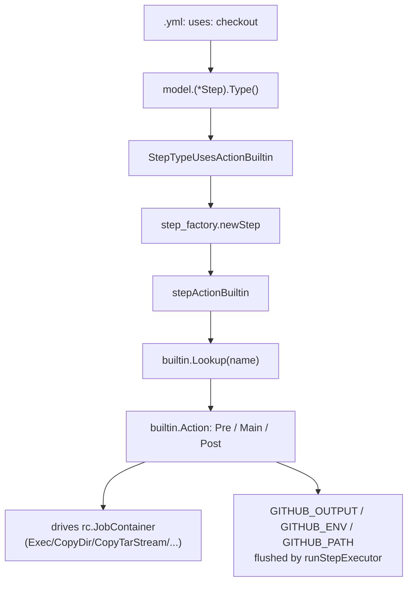

# Built-in actions

> Status: design + initial scaffold (`checkout` only).
> Audience: contributors to `act_runner`, and operators who want to understand
> what runs natively versus what is fetched and executed inside the job
> container.

## Why built-ins

In 2019 the original `actions/runner` shipped `checkout` and the artifact
upload/download as functionality compiled into the runner itself. They were
not GitHub Actions in the modern sense: there was no `action.yml`, no clone,
no JavaScript - just code paths the runner knew about.

The Microsoft "JS" rewrite then re-implemented those primitives as Node.js
actions distributed through `actions/checkout`, `actions/upload-artifact`,
`actions/download-artifact` and friends. Every job now has to:

- look up the action,
- clone it from a Git host,
- copy the working tree into the job container,
- ship a Node runtime into the container (or rely on one being there),
- and finally run the JS entrypoint.

That is a lot of work to hand a workspace to the user, especially on
self-hosted Gitea where the runner is already authenticated, already has Go
networking primitives, and already runs a custom artifact server in-process
([`act/artifacts/server.go`](../act/artifacts/server.go)) and an artifact
cache ([`act/artifactcache`](../act/artifactcache/)).

`act_runner` is not bound to GitHub's distribution model. It can offer the
common primitives directly, written in Go and linked into the runner binary.
This document describes how that works, what the workflow-author surface
looks like, and how to add new built-ins.

## What is a built-in

A built-in action is:

- A Go type implementing the [`builtin.Action`](../act/runner/builtin/builtin.go)
  interface.
- Registered into a process-wide registry at `init()` time (via a blank
  import in [`act/runner/builtins_register.go`](../act/runner/builtins_register.go)).
- Reached from a workflow with a reserved no-slash name in `uses:`, for
  example `uses: checkout`.
- Executed in the runner process. It may drive the job container through
  the existing [`container.ExecutionsEnvironment`](../act/container/executions_environment.go)
  interface (`Exec`, `CopyDir`, `CopyTarStream`, `Copy`, `GetContainerArchive`).

There is no `action.yml`, no clone, no Node runtime, no Docker build for a
built-in. There is also no `model.Action`: the runner takes the
`stepActionBuiltin` path which is parallel to `stepRun` rather than to the
"uses an action" paths.

## Workflow-author surface

```yaml
name: ci
on: [push]
jobs:
  build:
    runs-on: ubuntu-latest
    steps:
      - uses: checkout            # built-in, no @ref, no /, no ./
        with:
          fetch-depth: 0
      - run: ls -la
```

Resolution rules:

1. `uses:` containing `docker://` -> `StepTypeUsesDockerURL` (unchanged).
2. `uses:` starting with `./` and pointing at a `.github/workflows/*.yml` ->
   `StepTypeReusableWorkflowLocal` (unchanged).
3. `uses:` containing `.github/workflows/...@...` ->
   `StepTypeReusableWorkflowRemote` (unchanged).
4. `uses:` starting with `./` -> `StepTypeUsesActionLocal` (unchanged).
5. `uses:` matching `^[a-z0-9][a-z0-9-]*$` (no `/`, no `@`, no `./`) ->
   `StepTypeUsesActionBuiltin` (new).
6. Anything else -> `StepTypeUsesActionRemote` (unchanged).

A `uses:` of `actions/checkout@v4` therefore keeps clone-and-run-Node
behavior. There is no implicit shadowing of `actions/*` in this iteration.

If the no-slash name is not registered, step construction fails with a
clear message listing the known built-ins, mirroring how `StepTypeInvalid`
is reported today.

## End-to-end flow



## Lifecycle

`stepActionBuiltin` plugs into the same `runStepExecutor` used by every
other step type. Concretely:

- `setupEnv` populates env from job/step env, GitHub env
  (`withGithubEnv`), and `INPUT_*` keys derived from `step.With`.
- `runStepExecutor` writes the `GITHUB_OUTPUT`, `GITHUB_STATE`,
  `GITHUB_PATH`, `GITHUB_ENV`, `GITHUB_STEP_SUMMARY` files (and their
  `GITEA_*` aliases) into the job container, runs the action, and then
  flushes those files back into the run context. Built-ins therefore get
  output / env / path commands "for free": they only need to write to the
  paths the env exposes if they want to set outputs or modify the job env.
- `Pre` and `Post` are only invoked when the built-in declares
  `HasPre()` / `HasPost()`. Their default if-expression is `always()`,
  matching the default applied to action.yml in
  [`act/model/action.go`](../act/model/action.go).

A built-in's `Main` receives a `*builtin.Context` containing:

- `Ctx context.Context`
- `RunContext` - narrowed interface back to `*runner.RunContext`
  (job container, config, github context, expression evaluator).
- `Step *model.Step`
- `Inputs map[string]string` - `step.With` keys, already interpolated.
- `Env map[string]string` - mutable; whatever you put in here is the step
  env at exec time.
- `Logger log.FieldLogger`

## The `Action` interface

```go
type Action interface {
    Name() string
    HasPre() bool
    HasPost() bool
    Pre(*Context) error
    Main(*Context) error
    Post(*Context) error
}
```

Built-ins are registered in their own `init()`:

```go
func init() {
    builtin.Register(&checkoutAction{})
}
```

and surfaced to the rest of the runner via a blank import in
`act/runner/builtins_register.go`:

```go
import _ "gitea.com/gitea/runner/act/runner/builtin/checkout"
```

The registry is a simple `map[string]Action` guarded by a mutex, with
duplicate registration treated as a programmer error (panic at init).

## First built-in: `checkout`

`uses: checkout` is intentionally a strict subset of `actions/checkout` v4.
Inputs honored in this iteration:

| Input          | Default                             | Notes                              |
| -------------- | ----------------------------------- | ---------------------------------- |
| `repository`   | `${{ github.repository }}`          | full `org/repo`                    |
| `ref`          | `${{ github.ref }}`                 | branch / tag / SHA                 |
| `token`        | `${{ github.token }}`               | used for HTTP basic auth on clone  |
| `path`         | `` (workspace root)                 | relative to `GITHUB_WORKSPACE`     |
| `fetch-depth`  | `1`                                 | passthrough hint, currently best-effort |
| `clean`        | `true`                              | reserved, currently no-op          |
| `submodules`   | `false`                             | reserved, currently no-op          |

Behavior:

1. **Skip-if-bound parity.** When `isLocalCheckout(ghc, step)` is true and
   `Config.NoSkipCheckout` is false, the built-in does exactly what the
   current `step_action_remote.go` short-circuit does:
   - if `Config.BindWorkdir` is true, no-op (workspace is already mounted);
   - else `JobContainer.CopyDir(<container path>, hostWorkdir + sep + ".",
     Config.UseGitIgnore)`.
2. **Otherwise.** Clone on the runner host with
   [`git.NewGitCloneExecutor`](../act/common/git/git.go) (which already
   supports token auth and `InsecureSkipTLS` for Gitea), into a per-step
   directory under `Config.ActionCacheDir`, and `JobContainer.CopyDir` the
   working tree into `<workspace>/<path>`.
3. **Post.** No-op for now. There is nothing analogous to a credential
   helper to clean up because the built-in does not write one.

## Security considerations

- The built-in runs in the runner process, with the runner's privileges.
  It must not exec arbitrary code from the workspace; everything it does
  is constrained to the documented `with:` inputs.
- The token for cloning is the same token already supplied to the runner
  (`Config.Token`, threaded through the github context). It is not
  exposed to the job container by the built-in.
- Reserved no-slash names are evaluated *only* if the workflow author
  wrote one - there is no automatic redirection from `actions/checkout`,
  so existing workflows are untouched.

## Adding a new built-in

1. Create `act/runner/builtin/<name>/<name>.go`.
2. Implement `builtin.Action` and register in `init()`.
3. Add a blank import to `act/runner/builtins_register.go`.
4. Add a row to the table below and a unit test that drives the action
   against a mock `container.ExecutionsEnvironment` (see
   `act/runner/container_mock_test.go` for the pattern).

## Out of scope (for now)

- Shadowing `actions/checkout@*`, `actions/upload-artifact@*`, etc., to
  redirect to built-ins. Deliberately not done; opt-in by name only.
- `upload-artifact`, `download-artifact`, `cache` (save/restore). The
  framework supports them - they would slot in next to `checkout` in
  `act/runner/builtin/` - but their concrete implementations land in a
  follow-up.
- Running built-ins inside a step container or as a different user. The
  built-in always runs in the runner process; it interacts with the job
  container only through the existing `container.ExecutionsEnvironment`
  interface.

## Catalog

| Name       | Status      | Replaces                                |
| ---------- | ----------- | --------------------------------------- |
| `checkout` | implemented | `actions/checkout`                      |

Future entries will be added here as they land.
